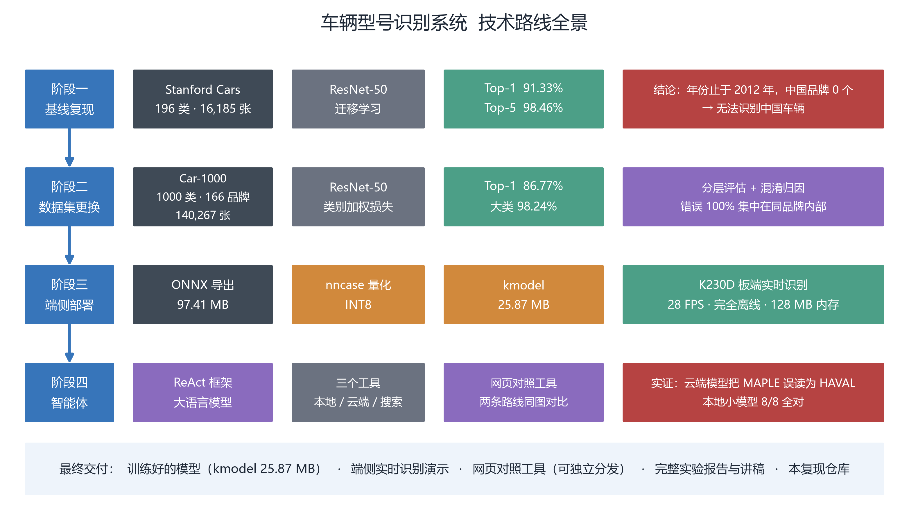
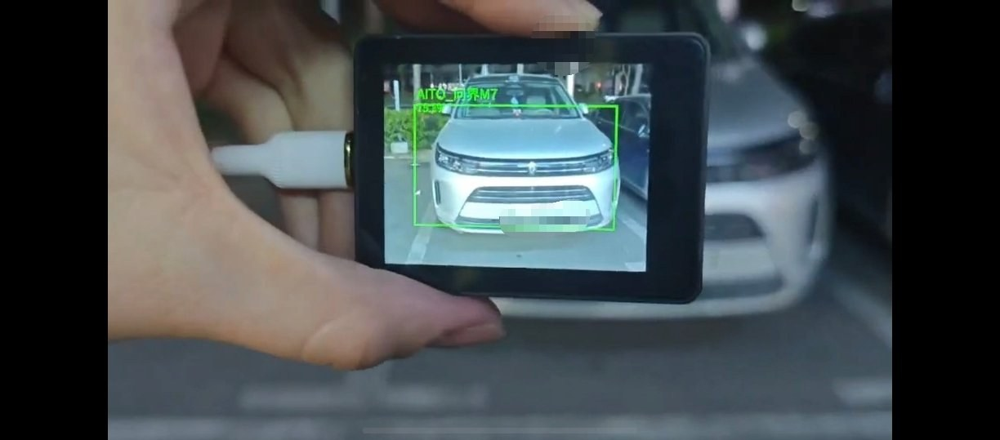
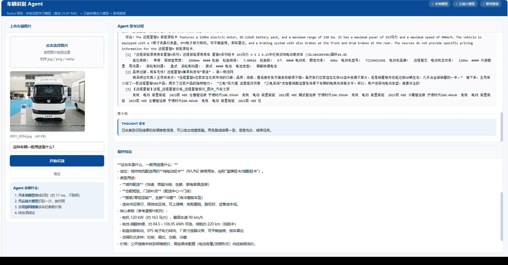
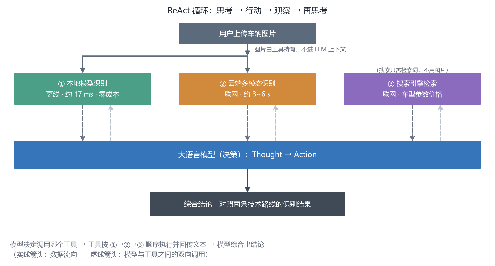
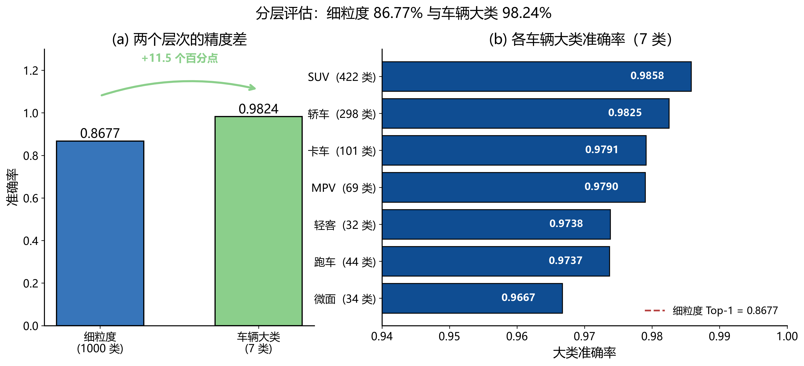
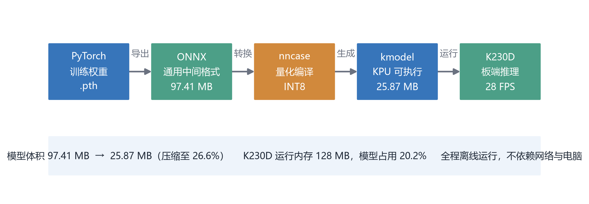

# 车辆型号识别系统

> 从 196 类美国车到 1000 类中国车，再到一块 300 元开发板上的实时识别
>  — A 1000-class Chinese vehicle recognition system built with ResNet-50,
deployed on a K230D edge board (28 FPS, fully offline, 25.87 MB INT8 model),
plus a ReAct agent that compares local and cloud vision models side by side.

基于深度学习的细粒度车辆型号识别，包含**模型训练**、**数据集更换**、**端侧部署**与**大模型智能体对照**四个阶段。
| | |
|---|---|
| Accuracy | Top-1 **86.77%** / Top-5 98.16% / vehicle-type 98.24% |
| Edge deployment | 97.41 MB → **25.87 MB** INT8, **28 FPS** offline on K230D |
| Agent | Local model + cloud multimodal LLM + web search, via ReAct loop |



---

## 这个项目做了什么

| 阶段 | 做了什么 | 关键结果 |
|:---:|---|---|
| **一** | 用 Stanford Cars 建立基线模型 | Top-1 **91.33%**，Top-5 98.46% |
| **二** | 更换为 Car-1000 中国车型数据集 | 1000 类，Top-1 **86.77%**，车辆大类 **98.24%** |
| **三** | 模型量化并部署到 K230D 开发板 | 97 MB → **25.87 MB**，板端 **28 FPS** 离线实时识别 |
| **四** | 搭建 ReAct 智能体，对照本地小模型与云端大模型 | 网页工具，实证云端模型会误读车标 |

---

## 效果展示

### ① K230D 开发板：完全离线的实时识别

<p align="center">
  
</p>

板端在 LCD 上画固定识别框，框上方给出**车型名 + 置信度**（图中识别为「AITO_问界M7」）。
全程**离线运行**，不接电脑、不联网，实测 **28 FPS**，靠充电宝供电即可。

### ② 网页 Agent：本地模型 / 云端大模型 / 联网搜索 三路对照

<p align="center">
  
</p>

左侧上传图片，右侧**实时显示 ReAct 循环的每一步**：
Thought（思考）→ Action（调用工具）→ Observation（观察结果）→ 下一轮，
最后综合三路结果给出结论。整套流程跑在本地 `http://127.0.0.1:8000`，
只有云端识别和搜索会联网。

Agent 的工作方式如下图所示（图片由工具持有，不进大模型上下文）：

<p align="center">
  
</p>

---

## 核心结果

### 两个数据集的对比

| 指标 | Stanford Cars | Car-1000 |
|---|---:|---:|
| 类别数 | 196 | **1000** |
| 品牌数 | 约 50（美国品牌） | **166**（含中国品牌） |
| 图片总数 | 16,185 | **140,267** |
| 年份覆盖 | 1991–2012 | 1960s–2020s |
| 中国品牌数 | **0** | 大量 |
| 测试集 Top-1 | 91.33% | **86.77%** |
| 测试集 Top-5 | 98.46% | 98.16% |
| 车辆大类准确率 | — | **98.24%** |

> ⚠️ 两个数据集的类别数与数据量不同，准确率**不能直接比较**。

### 分层评估

| 评估层次 | 类别数 | 准确率 |
|---|---:|---:|
| 细粒度（具体车型） | 1000 | 86.77% |
| 车辆大类 | 7 | **98.24%** |

**两者的 11.5 个百分点差距说明**：模型几乎不会把 SUV 认成轿车，
错误全部集中在同一大类内部。进一步统计最严重的 100 组误认，
发现 **100% 发生在同品牌内部，跨品牌误认为 0 次**。

主要失败模式是**同款车的不同动力形式**（燃油 / 插混 / 纯电），
例如领克 01 与领克 01 PHEV、沃尔沃 XC90 与 XC90 RECHARGE。

<p align="center">
  
</p>

左图是细粒度（86.77%）与车辆大类（98.24%）的 11.5 个百分点差距；
右图是 7 个车辆大类的各自准确率，最低的「微面（34 类）」也有 96.67%。

### 端侧部署

<p align="center">
  
</p>

从 PyTorch 权重到板端 kmodel 的完整链路，体积从 97.41 MB 压到 25.87 MB（26.6%）。

| 项目 | 数值 |
|---|---:|
| 浮点模型（ONNX） | 97.41 MB（未随仓库分发） |
| **随仓库附带的量化模型（INT8 ONNX）** | **24.53 MB** |
| 量化模型（kmodel，板端） | **25.87 MB** |
| K230D 运行内存 | 128 MB（模型占 20.2%） |
| 板端实测帧率 | **28 FPS** |
| 是否离线 | **完全离线** |
| ONNX 与 PyTorch 对拍一致率 | 100.00% |

---

## 快速开始

### 路径 A：直接看识别效果（约 5 分钟，不需要显卡）

```bash
# 1. 装环境（也可以直接双击 install.bat 自动完成）
pip install torch torchvision --index-url https://download.pytorch.org/whl/cu126
pip install -r requirements.txt

# 2. 自检环境
python check_env.py

# 3. 跑网页 Agent —— 双击 04_代码_网页Agent/start.bat
#    浏览器会自动打开，上传车辆图片即可
```

仓库 `05_模型文件/` 已自带模型，**不需要训练、不需要下载**：

| 文件 | 用途 |
|---|---|
| `cars1000_resnet50_224_int8.onnx`（24.53 MB） | 电脑端 / 网页 Agent |
| `cars1000_resnet50_224.kmodel`（25.87 MB） | K230D 板端 |

### 路径 B：自己训练 + 命令行识别（约 2 小时）

```bash
# 1. 整理数据集（详见 06_复现指南 第 2 步）
python 02_代码_模型训练/prepare_car1000.py --root <原始目录> --out <输出目录>

# 2. 训练（约 97 分钟，RTX 4060 8 GB）
python 02_代码_模型训练/train_car1000.py --data <输出目录>

# 3. 单张图片识别（注意参数是 --img）
python 02_代码_模型训练/predict_car1000.py --img 你的图片.jpg
```

> 📌 `predict_car1000.py` 需要训练产出的 `.pth`（97.80 MB，未随仓库分发）。
> 不想训练就走路径 A。

### 路径 C：部署到 K230D 开发板（约 30 分钟）

转换环境用 `install-k230.bat` 一键安装，步骤见
[`03_代码_K230部署/README.md`](03_代码_K230部署/README.md) 与 `06_复现指南` 第 7 步。

### 依赖文件说明

| 依赖文件 | 适用于 | Python 要求 |
|---|---|---|
| `requirements.txt` | 训练、评估、预测、网页 Agent | 3.12 推荐（3.13/3.14 亦可） |
| `requirements-k230.txt` | 只有 K230 模型转换（nncase） | **必须 3.10–3.12** |

> ⚠️ PyTorch 故意没写进 `requirements.txt` —— Windows 上直接 `pip install torch`
> 会装到 CPU 版。`install.bat` 会检测显卡并自动装 CUDA 版。

### 想从零复现整个项目？

👉 **看 [06_复现指南/复现指南.md](06_复现指南/复现指南.md)** —— 写给零基础的人，从装 Python 开始。

---

## 仓库结构

```
.
├── README.md                    ← 本文件
├── LICENSE
├── .gitignore
│
├── requirements.txt             ← 主环境依赖清单（训练/推理/Agent）
├── requirements-k230.txt        ← K230 转换环境依赖清单（nncase）
├── install.bat                  ← 一键安装主环境（双击即可）
├── install-k230.bat             ← 一键安装 K230 转换环境
├── check_env.py                 ← 环境自检（逐项检查依赖与显卡）
│
├── 01_技术路线图/                ← 技术路线全景图、流水线图、结果图
├── 02_代码_模型训练/             ← 数据准备 → 训练 → 评估 → 导出
├── 03_代码_K230部署/             ← 模型转换 → 板端程序
├── 04_代码_网页Agent/            ← ReAct 智能体与网页界面
├── 05_模型文件/                  ← kmodel（板端）+ INT8 ONNX（电脑端）+ 类别标签表
├── 06_复现指南/                  ← 零基础复现教程
├── 07_脚本总账/                  ← 全部脚本清单与用途说明
└── 08_技术文档/                  ← 开发过程的技术记录与实测结论
```

---


## 使用者需要自行准备的部分

本节说明哪些内容已随仓库提供、哪些需要使用者自行准备。

### 已随仓库提供

| 内容 | 位置 |
|---|---|
| 全部源码 | `02_` `03_` `04_` 三个代码目录 |
| **训练好的模型**（板端 kmodel + 电脑端 INT8 ONNX） | `05_模型文件/` |
| 1000 类中文/英文标签表、7 大类映射 | `05_模型文件/` |
| 依赖清单与一键安装脚本 | `requirements*.txt`、`install*.bat` |
| 环境自检脚本 | `check_env.py` |
| 全部图表、复现指南与技术文档 | `01_` `06_` `07_` `08_` `09_` |

### 需要使用者自行准备的事项（按必要性排序）

| # | 事项 | 必须吗 | 说明 |
|:---:|---|---|---|
| 1 | **安装 Python 3.12** | ✅ 必须 | 从 python.org 下载，安装时勾选 `Add python.exe to PATH` |
| 2 | **运行 `install.bat`** | ✅ 必须 | 自动装 PyTorch（检测显卡选 CUDA 版）与其余依赖 |
| 3 | **申请 API 密钥** | ⬜ **可选** | 只有要用「云端多模态识别」和「联网搜索」才需要；**本地模型识别完全不需要密钥** |
| 4 | **填 API 密钥** | ⬜ 可选 | 把 `04_代码_网页Agent/config.example.ini` 复制为 `config.ini`，填入自己的密钥 |
| 5 | **准备数据集** | ⬜ 仅训练时需要 | Car-1000 共 140,267 张图，需从发布方获取；**不训练就不用管** |
| 6 | **K230D 开发板** | ⬜ 仅上板时需要 | 淘宝约 300 元；只做电脑端演示不用买 |
| 7 | **Python 3.10–3.12 第二个环境** | ⬜ 仅转换模型时需要 | 运行 `install-k230.bat` 时会自动建虚拟环境；若默认环境为 3.14 则需另装 3.12 |

**关于 API 密钥**（第 3、4 项）：

| 密钥 | 用途 | 获取地址 | 大概成本 |
|---|---|---|---|
| DeepSeek | 云端多模态对照识别 | https://platform.deepseek.com | 极低，充 10 元够用很久 |
| Tavily | 联网搜索车型参数 | https://tavily.com | 有免费额度 |

> ⚠️ **不填密钥也能跑**：网页 Agent 的本地识别、结果与置信度显示都正常，
> 只是「云端识别」和「联网搜索」两步会返回"未配置密钥"的提示。
> 作为课程演示，**只跑本地模型就足以体现端侧部署的价值**。

> 🔒 仓库里**不含任何真实密钥**，只有 `config.example.ini` 占位模板。
> `config.ini` 已被 `.gitignore` 排除，永远不会被提交。

---

## 文档导航

| 想了解… | 看这里 |
|---|---|
| 怎么从零复现整个项目 | [06_复现指南/复现指南.md](06_复现指南/复现指南.md) |
| 每个脚本是干什么的 | [07_脚本总账/脚本总账.md](07_脚本总账/脚本总账.md) |
| 项目的技术细节 | [`08_技术文档/`](08_技术文档/) |
| K230D 怎么上板 | [`08_技术文档/10_K230D上板实战指南.md`](08_技术文档/10_K230D上板实战指南.md) |
| 踩过哪些坑 | [08_技术文档/01_问题与发现汇总.md](08_技术文档/01_问题与发现汇总.md) |
| 为什么说大模型会幻觉 | [08_技术文档/14_云端大模型能力实测.md](08_技术文档/14_云端大模型能力实测.md) |

---

## 数据集

本项目使用两个数据集，**均不包含在本仓库内**（体积过大）。

### Car-1000（主数据集）

| 项目 | 内容 |
|---|---|
| 规模 | 1,000 类车型 / 166 个品牌 / 140,267 张图片 |
| 年份覆盖 | 1960 年代 – 2020 年代 |
| 标签体系 | 中文「品牌_车型」，另附 7 类车辆大类标签 |
| 数据来源 | 中国汽车媒体「懂车帝」 |
| 发布信息 | 2025 年由北京航空航天大学、上海人工智能实验室、东南大学等合作发布 |
| 官方划分 | 训练 83,756 / 验证 27,658 / 测试 28,853 |

> 数据集的获取方式请见 [06_复现指南/复现指南.md](06_复现指南/复现指南.md) 第 2 章。
> 请注意遵守数据集自身的许可协议，仅用于学习研究。

### Stanford Cars（基线对照）

Stanford Cars 是细粒度车辆识别的经典基准，196 类、16,185 张图片。
本仓库的 `02_代码_模型训练/prepare_cars.py` 可将其整理为训练所需结构。

---

## 环境要求

| 用途 | 环境 |
|---|---|
| 模型训练 | Python 3.10+，PyTorch 2.x，CUDA（本项目用 RTX 4060 Laptop 8 GB） |
| 模型转换 | **独立的** Python 3.10–3.12 环境（nncase 只支持 cp39–cp313） |
| 板端运行 | CanMV IDE + K230D 开发板 |
| 网页 Agent | Python 3.10+，需联网 |

> ⚠️ **重要**：模型转换必须用独立环境。训练环境（如 Python 3.14）装不上 nncase。
> 原因见 [../08_技术文档/01_问题与发现汇总.md](08_技术文档/01_问题与发现汇总.md)。

---

## 已知局限

这里主动说明项目的边界：

| 局限 | 说明 |
|---|---|
| **视角受限** | 训练图以正面和侧前方 45° 为主，**正侧面识别率会下降** |
| **类别不均衡** | 最多的类 200+ 张图，最少的仅 2 张，相差 31 倍 |
| **分类而非检测** | 模型只输出「是什么车」，不输出位置，板端框为固定位置 |
| **云端依赖网络** | 网页 Agent 的云端识别与搜索需要联网 |
| **置信度不可直接判定对错** | 实测：认对时置信度可能仅 10%，认错时也可能 100% |

---

## 关于本项目的说明

本项目源于一门数字图像处理课程的大作业，后续整理为可独立复现的开源项目。

开发过程中使用了 AI 辅助编程。所有代码均在本机实际运行验证，
所有数据均来自实际实验记录，技术文档记录了完整的踩坑与排查过程。

---

## 引用

如果你在研究中用到本项目的思路，可参考：

```bibtex
@misc{vehicle-recognition-2026,
  title  = {车辆型号识别系统：从数据集选择到端侧部署},
  note   = {开源项目},
  year   = {2026}
}
```

### 相关论文

- Krause J, Stark M, Deng J, et al. *3D Object Representations for Fine-Grained Categorization*. ICCV Workshops, 2013.
- He K, Zhang X, Ren S, et al. *Deep Residual Learning for Image Recognition*. CVPR, 2016.
- Yao S, Zhao J, Yu D, et al. *ReAct: Synergizing Reasoning and Acting in Language Models*. ICLR, 2023.

---

## 许可

代码部分采用 MIT 许可，详见 [LICENSE](LICENSE)。

数据集与模型权重可能受各自许可约束，请注意区分。
